<div align="center">


### Tune the Logitech PRO X3 / PRO X2 SUPERSTRIKE, and save all of it in the mouse.

Actuation point, rapid trigger and **click haptics**, button actions, DPI and polling rate are
written straight into the mouse's **onboard memory**. They keep working on any PC, in any game,
with this app closed and no Logitech software installed. A small native app for **Linux** and
**Windows**: no background service, no account, no telemetry.

[](https://github.com/Adhamura/SuperStrike-Studio/actions/workflows/ci.yml)
[](https://github.com/Adhamura/SuperStrike-Studio/releases)
[](https://github.com/Adhamura/SuperStrike-Studio/releases)
[](LICENSE)


[**Download for Windows**](https://github.com/Adhamura/SuperStrike-Studio/releases/latest) ·
[**Download for Linux (AppImage)**](https://github.com/Adhamura/SuperStrike-Studio/releases/latest) · [Screenshots](#screenshots) · [Why](#why-superstrike-studio) ·
[Performance](#light-on-your-pc) · [Updates](#updates) · [FAQ](#faq)

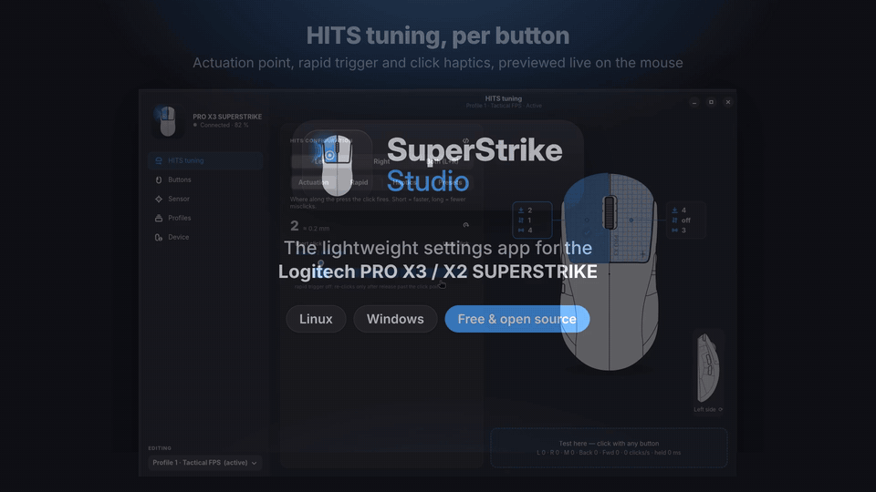

<sub>Recorded from the real app with <code>--demo</code> (a simulated mouse). Full video with
captions: <a href="docs/promo/superstrike-studio.mp4">superstrike-studio.mp4</a> (41 s, 1080p).</sub>

</div>

> [!NOTE]
> **Not affiliated with or endorsed by Logitech.** SuperStrike Studio is an independent open-source
> project. Logitech, G HUB, PRO, LIGHTSPEED and SUPERSTRIKE are trademarks of Logitech and are used
> only to name the hardware. Use at your own risk: the app backs up the whole mouse memory before
> the first save of each session.

## Why SuperStrike Studio

The PRO X SUPERSTRIKE has HITS (Haptic Inductive Trigger System): inductive main buttons with an
adjustable actuation point, rapid trigger and a haptic click. SuperStrike Studio gives you all of
it, and puts the result where it belongs: in the mouse.

- **💾 Saved in the mouse, haptics included.** Every setting goes into the onboard profiles:
  actuation, rapid trigger, **haptic strength**, buttons, DPI stages, polling rate. Unplug the
  receiver, take it to another PC, a LAN or a tournament machine: your mouse feels the same.
- **🪶 Close the app and play.** Nothing stays running: no service, no tray icon, no updater, no
  overlay. While it is open it uses about 0.05 % CPU; when it is closed it uses nothing.
  [Measurements below.](#light-on-your-pc)
- **🎯 HITS tuning per button.** Left, right or both: actuation point 1–10 on a press-travel bar,
  rapid trigger on/off and level 1–5, haptics 0–5, live preview on the mouse while you edit,
  your own presets, 12 published pro-player presets, and G HUB HITS codes (import and copy).
- **🖱️ Every button.** Left, right, middle, back and forward on a top and side drawing of the
  mouse: mouse buttons, keys with modifiers (or record a key), media keys, DPI and profile
  functions, and a separate DPI-shift layer.
- **📈 Sensor.** Five DPI stages from 100 to 48 000 with separate X / Y and lift-off distance,
  polling up to 8 000 Hz wireless and 1 000 Hz cable, angle snapping, scroll filter, gaming
  surface mode, power saving.
- **🗂️ Five onboard profiles.** Rename, profile cycle, activate, copy, reset to factory from the
  mouse ROM, export / import JSON, and whole-memory backup and restore.
- **🧪 Try it without the mouse.** `--demo` runs every page with a simulated PRO X3 SUPERSTRIKE.
- **🌍 21 languages**, switchable while the app runs, right-to-left for Arabic and Urdu.
- **🔄 Updates from GitHub.** The app tells you when a new release is out and opens its page;
  one small request a day, and you can turn it off.
- **🔓 Open and private.** C++ with GTK 4 / libadwaita, MIT licensed, no telemetry, no account.

### Made for competitive play

- **Your settings travel with the mouse.** Event and LAN PCs often do not allow installing
  software. With everything in onboard memory you plug in the receiver and play.
- **Nothing competes with the game.** No background process means no CPU time or memory taken
  from the game, and nothing that can pop up mid-match.
- **One click per change, felt at once.** HITS edits to the active profile reach the mouse live; the
  test pad shows clicks per second and hold time, so you can compare actuation and rapid trigger
  levels on the spot.
- **Pro presets as a start.** HITS values published for CS2, Valorant, League of Legends and
  Rainbow Six players, as G HUB HITS codes you can share with your team.

## Screenshots

<table>
  <tr>
    <td width="50%">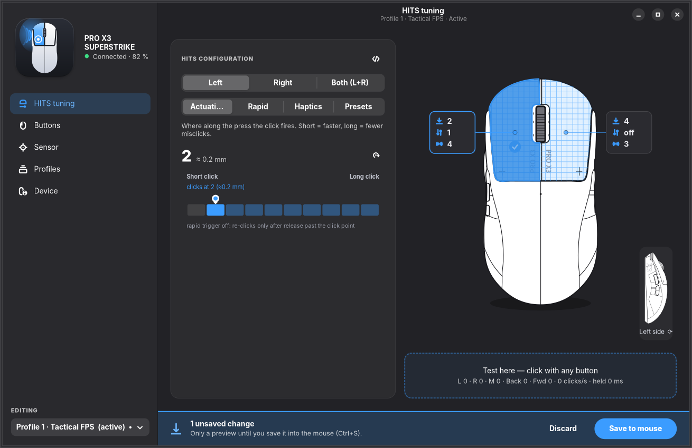<br><b>HITS tuning</b>: actuation on a press-travel bar, left and right values on the drawing, test pad, and the save bar</td>
    <td width="50%">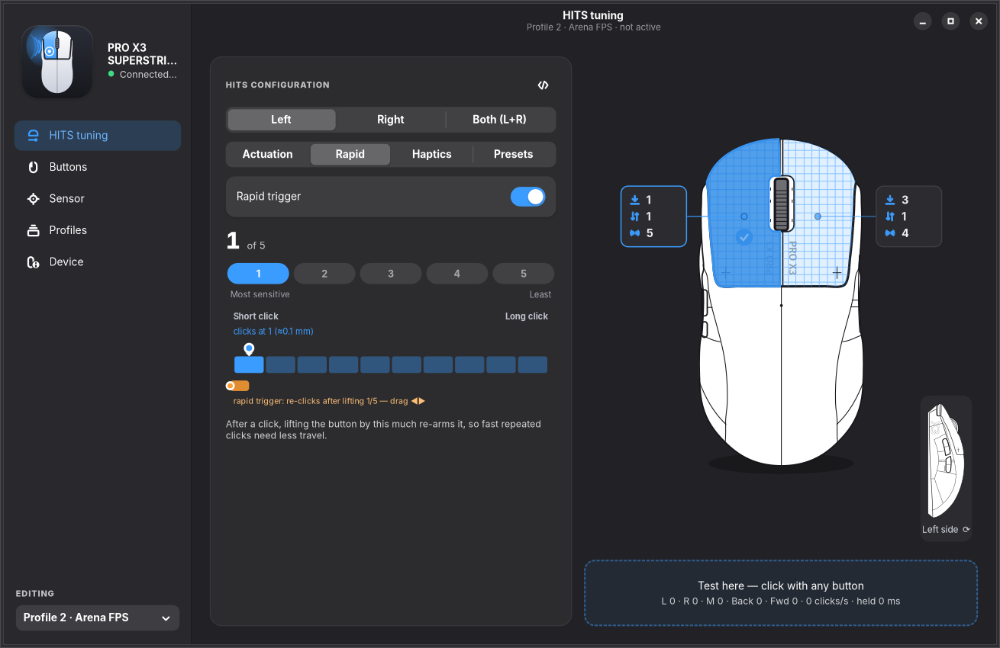<br><b>Rapid trigger</b>: on/off and level 1–5, with the reset zone shown on the travel bar</td>
  </tr>
  <tr>
    <td>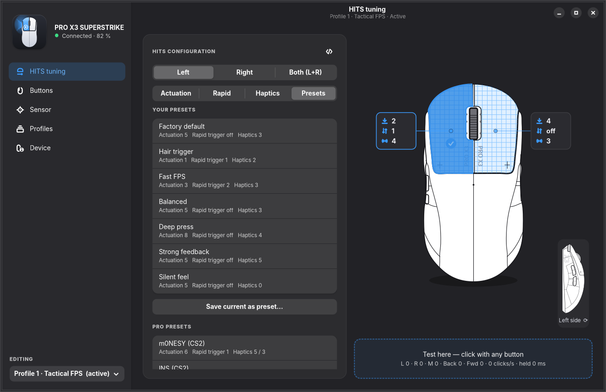<br><b>Presets</b>: your own, built-in and published pro-player HITS codes</td>
    <td>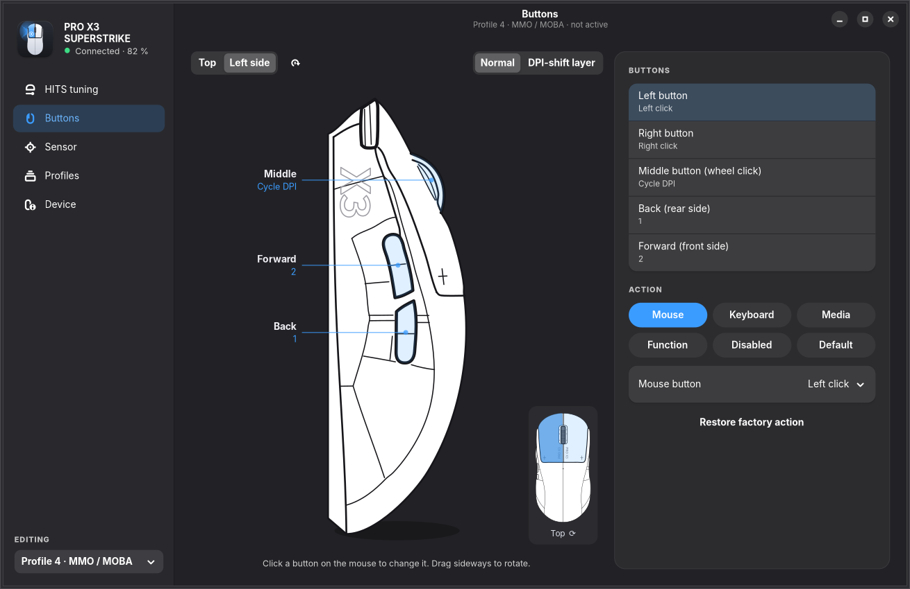<br><b>Buttons</b>: side view; back and forward send keys, middle cycles DPI</td>
  </tr>
  <tr>
    <td>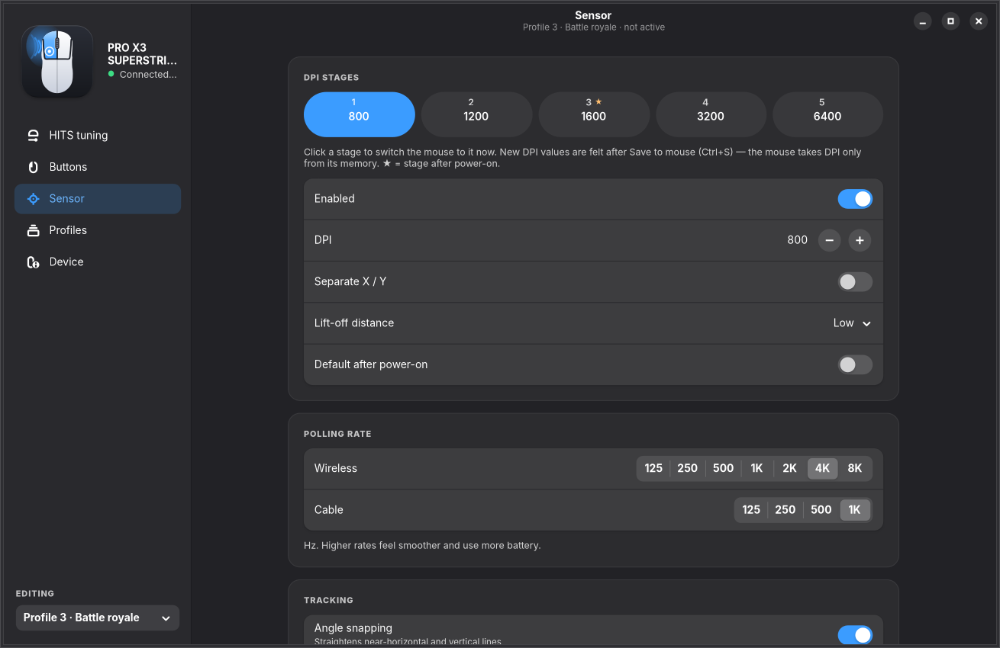<br><b>Sensor</b>: five DPI stages, polling rate for wireless and cable, tracking and power</td>
    <td>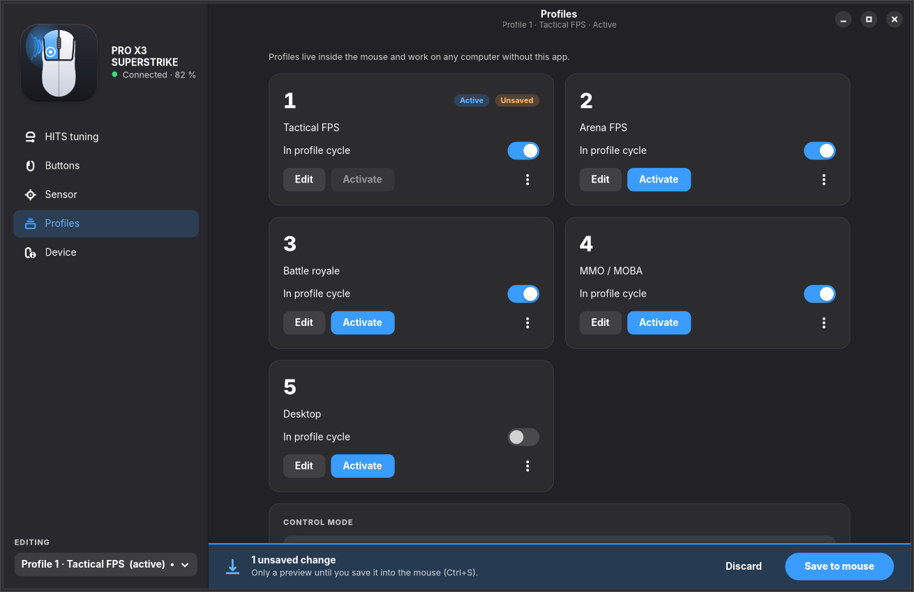<br><b>Profiles</b>: the five onboard profiles, profile cycle, activate, copy, export, backup</td>
  </tr>
  <tr>
    <td>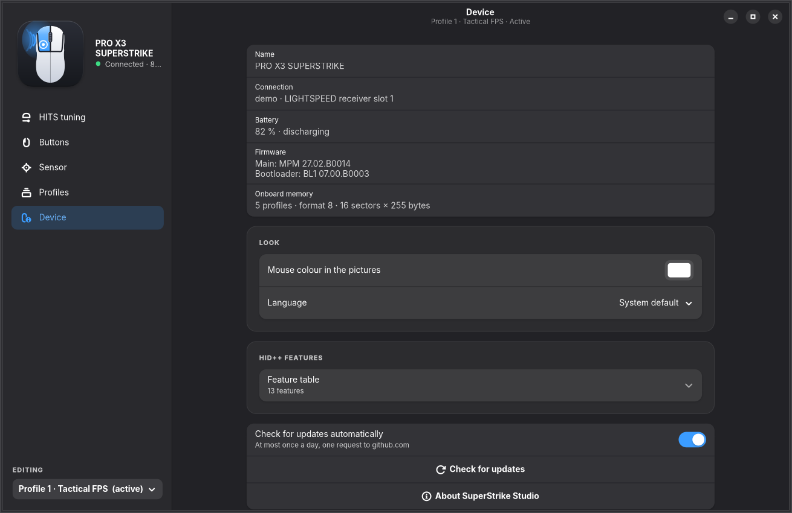<br><b>Device</b>: connection, battery, firmware, onboard memory, HID++ features, language</td>
    <td>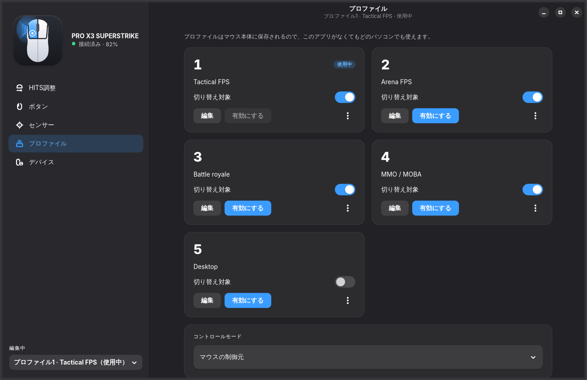<br><b>21 languages</b>: here Japanese, switched while the app runs</td>
  </tr>
</table>

<sub>Screenshots and the video show the real app running with the demo mouse (<code>--demo</code>). They are
made by <code>tools/screenshots/capture.sh</code> and <code>tools/promo/make_promo.sh</code>.</sub>

## Light on your PC

Measured on Linux (x86_64, GTK 4.24, libadwaita 1.10) with the demo mouse, after 15 s of start-up,
over 60 s with the window open and idle:

| | SuperStrike Studio |
|:--|:--|
| CPU while open and idle | **≈ 0.05 %** of one core (3–4 scheduler ticks per minute: the battery check) |
| Memory while open | **≈ 45 MB** private (cairo renderer), ≈ 135 MB RSS including the shared GTK libraries; ≈ 200 MB RSS with the GL renderer |
| CPU and memory while you game | **0**: close the window, the settings stay in the mouse |
| Program size | **≈ 370 KB** binary (Linux), plus GTK |
| Processes at start-up | **none**: no service, no tray icon, no updater |
| Network | **one HTTPS request a day** to api.github.com for the update check (can be turned off), nothing else |

<sub>CPU from <code>/proc/PID/stat</code>, memory from <code>/proc/PID/status</code> and <code>smaps</code>. Your numbers depend on
the GPU driver and the desktop. On Windows the app ships the GTK libraries in its folder.</sub>

## How it compares

| | **SuperStrike Studio** | Logitech G HUB |
|---|:--|:--|
| Linux | ✅ | ❌ |
| Windows | ✅ | ✅ |
| macOS | ❌ | ✅ |
| HITS actuation, rapid trigger, haptics | ✅ | ✅ |
| Haptics kept in the onboard profiles | ✅ | ❌ ¹ |
| Works with the app closed, no background service | ✅ | ➖ onboard mode only |
| Pro presets and HITS codes | ✅ | ✅ |
| Account, telemetry | none | optional account |
| Update check | in the app, once a day, can be turned off | background update service |
| Lighting, macros, other Logitech devices | ❌ | ✅ |
| Open source | ✅ MIT | ❌ |

<sub>✅ yes · ➖ partial · ❌ no. ¹ In our tests with a PRO X3 SUPERSTRIKE. G HUB is a much bigger
product for the whole Logitech line-up; SuperStrike Studio does one mouse, and keeps out of the way.
Corrections are welcome in an issue.</sub>

## Install

### Windows

1. Download **SuperStrike-Studio-&lt;version&gt;-windows-x64.exe** from
   [**Releases**](https://github.com/Adhamura/SuperStrike-Studio/releases/latest).
2. Run it. That is all: one file, nothing to unzip.
3. **Close Logitech G HUB** first (also in the tray, near the clock): it can keep the receiver busy.

No installer, no admin rights. The first start unpacks the app once to
`%LOCALAPPDATA%\SuperStrike-Studio` (a few seconds); later starts are instant. SmartScreen may say "Windows protected your PC" because the exe is
not signed with a paid certificate: click **More info → Run anyway**. Check the download with
`sha256sum -c SHA256SUMS --ignore-missing`. Settings live in `%LOCALAPPDATA%\superstrike`.
To build it yourself, double-click **`build-windows.bat`** (it installs MSYS2 and the build
packages when they are missing) or see [`tools/windows/README-windows.txt`](tools/windows/README-windows.txt).

### Linux

Download **SuperStrike-Studio-&lt;version&gt;-x86_64.AppImage** from
[**Releases**](https://github.com/Adhamura/SuperStrike-Studio/releases/latest) and run it:

```bash
chmod +x SuperStrike-Studio-*-x86_64.AppImage && ./SuperStrike-Studio-*-x86_64.AppImage
```

One file with GTK 4 and libadwaita inside: it runs on any x86_64 distro. If the app says it has no
permission for `/dev/hidraw*`, add the udev rule once (`sudo ./install.sh --udev` from the sources
does the same):

```bash
echo 'KERNEL=="hidraw*", SUBSYSTEM=="hidraw", ATTRS{idVendor}=="046d", TAG+="uaccess"' | sudo tee /etc/udev/rules.d/70-superstrike.rules
sudo udevadm control --reload-rules && sudo udevadm trigger --subsystem-match=hidraw
```

#### Build from source

Needs GTK 4, **libadwaita 1.7+**, librsvg, json-glib, CMake, gettext and a C++20 compiler
(glib-networking for the update check; most desktops have it):

| Distro | Packages |
|---|---|
| Arch, CachyOS, Manjaro | `sudo pacman -S --needed gtk4 libadwaita librsvg json-glib glib-networking cmake gettext base-devel` |
| Fedora 42+ | `sudo dnf install gtk4-devel libadwaita-devel librsvg2-devel json-glib-devel glib-networking cmake gettext gcc-c++` |
| Ubuntu 25.04+, Debian 13 | `sudo apt install libgtk-4-dev libadwaita-1-dev librsvg2-dev libjson-glib-dev glib-networking cmake gettext g++` |

```bash
git clone https://github.com/Adhamura/SuperStrike-Studio && cd SuperStrike-Studio
./install.sh               # builds build/release/superstrike-studio, adds an app-menu entry and a launcher
sudo ./install.sh --udev   # once, if the app says it has no permission for /dev/hidraw*
```

`install.sh` also builds `sscheck`, a read-only device check (it never writes to the mouse).

### Try it without the mouse

```bash
superstrike-studio --demo      # Windows: superstrike-studio.exe --demo
```

Every page works with a simulated PRO X3 SUPERSTRIKE (five profiles, HITS, DPI, battery). Changes
stay in memory and nothing is sent to a real mouse.

## Updates

SuperStrike Studio checks GitHub for a new release when it starts, **at most once a day**. When
there is one, it shows the version and its release notes and offers **Open download page** (the
GitHub release with the Windows exe and the Linux AppImage; from source, `git pull && ./install.sh`), **Later** or **Skip
this version**. **Device → Check for updates** checks right away; **Check for updates
automatically** turns the daily check off.

The check is one HTTPS request to `api.github.com/repos/Adhamura/SuperStrike-Studio/releases/latest`
with the user agent `SuperStrike-Studio/<version>`. Nothing about you or your mouse is sent, and
nothing is downloaded or installed by itself. `superstrike-studio --check-updates` does the same
from a terminal.

<p align="center">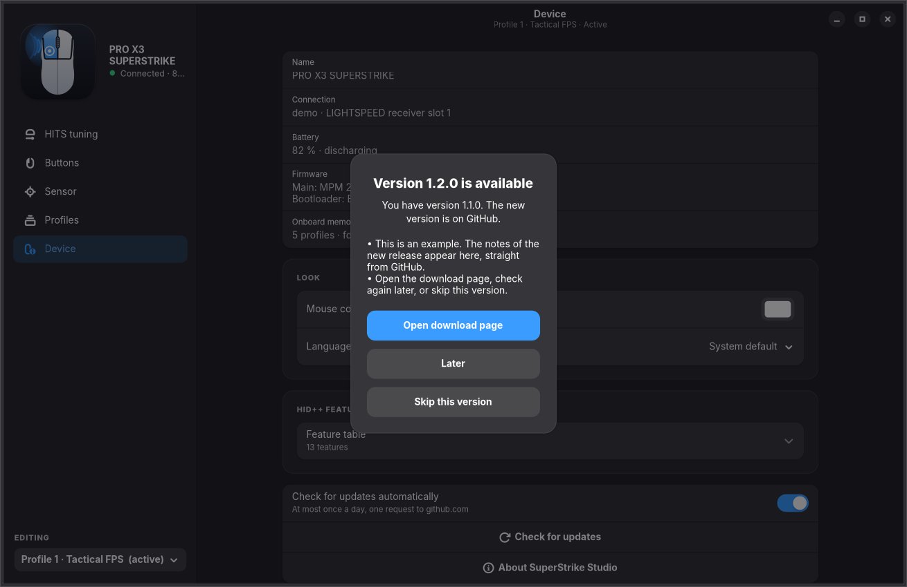</p>

## How it works

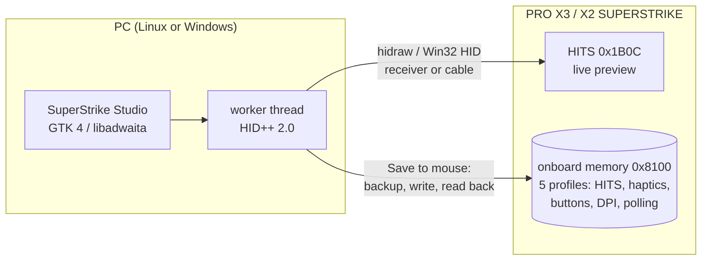

The app speaks HID++ 2.0 directly to the mouse, through the LIGHTSPEED receiver or the cable.
Edits to the active profile are sent live through the HITS feature (`0x1B0C`), so you feel them
at once. **Save to mouse** writes the changed 255-byte profile sectors through the onboard-profile
feature (`0x8100`), with a CRC, reads each one back and compares it, then reloads the profile.
Before the first save of a session the whole memory is backed up to a JSON file.

<details>
<summary>Project layout</summary>

| Path | What |
|---|---|
| `src/hidpp*.cpp` | HID++ 2.0 transport (Linux hidraw, Windows HID API) |
| `src/hid_sim.cpp` | the demo mouse (`--demo`): answers HID++ like a PRO X3 SUPERSTRIKE |
| `src/device.cpp` | SUPERSTRIKE features: HITS `0x1B0C`, report rate `0x8061`, DPI `0x2202`, onboard profiles `0x8100`, … |
| `src/profile.cpp` | onboard profile sector format, button actions, HITS codes |
| `src/app.cpp`, `src/window.cpp` | worker thread, saving, window |
| `src/page_*.cpp` | the five pages |
| `src/mouseview*.cpp`, `src/levelbars.cpp` | drawn widgets (mouse, travel bar, level bars) |
| `assets/` | mouse drawings, icons, logo, stylesheet |
| `po/` | translations (`po/update-pot.sh` refreshes the template) |
| `tools/sscheck.cpp` | read-only device check |
| `build-windows.bat`, `tools/windows/` | Windows build (MSYS2 UCRT64): portable folder and one-file exe |
| `tools/linux/` | Linux AppImage |
| `tools/screenshots/`, `tools/promo/` | README screenshots and the promo video, made with the demo mouse |
| `DESIGN.md` | UI design spec |
</details>

## FAQ

**Do my settings work without the app?**
Yes. Everything is saved in the mouse's onboard profiles. Close the app, uninstall it, or use
another PC: the mouse keeps its HITS, haptics, buttons, DPI and polling rate.

**Can it break my mouse?**
The app only writes the profile sectors and the profile directory, never the factory profile in
ROM. Every write is checked by reading it back. Before the first save of each session the
whole memory is backed up (`~/.local/share/superstrike/backups`, Windows
`%LOCALAPPDATA%\superstrike\backups`); **Profiles → Restore from backup…** puts it back, and
**Reset to factory** copies the ROM profile.

**Can I use it together with G HUB?**
Not at the same time: close G HUB (also in the tray) while you use SuperStrike Studio, or it may
keep the receiver busy. Keep **Profiles → Control mode** on *Onboard memory* (recommended), so the
mouse uses the profiles saved in it.

**Does it work with the PRO X2 SUPERSTRIKE?**
The app finds any Logitech mouse with the HITS feature and was verified on a PRO X3 SUPERSTRIKE.
The PRO X2 SUPERSTRIKE uses the same features; reports are welcome.

**Why does the live click view only react over the window on Windows?**
Windows does not let a program read the mouse buttons in the background the way Linux hidraw
does. Everything else works the same.

**The app says "Mouse not found".**
Switch the mouse on or move it, plug in the receiver, close G HUB, then **Retry**. On Linux, run
`sudo ./install.sh --udev` once if it reports no permission for `/dev/hidraw*`. `sscheck` (built
next to the app) checks the connection without writing anything.

**How do I report a bug?**
[Open an issue](https://github.com/Adhamura/SuperStrike-Studio/issues/new/choose) with the app
version (`superstrike-studio --version`), the mouse firmware (Device page) and your system.

## Roadmap

- **1.0**: ✅ HITS (actuation, rapid trigger, haptics), buttons, DPI, polling, five onboard
  profiles with backup and restore, demo mode, 21 languages, Linux and Windows.
- **1.1**: ✅ update check from GitHub releases.
- **1.1.1**: ✅ one-file downloads: a Windows exe and a Linux AppImage (no zip), `build-windows.bat`.
- **Ideas, not scheduled**: AUR package and Flatpak; Windows installer; more Logitech mice with HITS.

Missing something? [Open an issue](https://github.com/Adhamura/SuperStrike-Studio/issues/new/choose).

## Contributing

Bug reports with the app version, mouse firmware and system help most. For code:

```bash
cmake -S . -B build/release -DCMAKE_BUILD_TYPE=MinSizeRel
cmake --build build/release -j
build/release/superstrike-studio --demo
```

CI builds on Arch Linux and on Windows (MSYS2 UCRT64), checks that every translation is complete,
and starts the app with the demo mouse to render every page on both systems.

- **Translations**: `po/<lang>.po` (GNU gettext). After changing strings run `po/update-pot.sh`
  and `msgmerge -U po/<lang>.po po/superstrike-studio.pot`.
- **Screenshots**: `tools/screenshots/capture.sh` (needs `xvfb-run` and the Inter font).
- **Promo video and GIF**: `tools/promo/make_promo.sh` (also ffmpeg, Chromium and python-xlib).

<details>
<summary>Versions and releases</summary>

The version is in `CMakeLists.txt` (`project(superstrike_studio VERSION x.y.z)`). It is shown in
**Device → About** and `--version`, and goes into the Windows exe.

**Releases are automatic.** Raise the version, add a `## <version>` section to `CHANGELOG.md`,
and merge to `main`. GitHub Actions builds and tests on Linux and Windows, then publishes the
release `v<version>` with the Windows exe, the Linux AppImage, `SHA256SUMS` and the changelog section as notes.
Releases from before 1.1.1 got the same one-file downloads afterwards with the **Repack an old
release** workflow (`.github/workflows/repack.yml`).
</details>

## Credits

Protocol knowledge cross-checked with [Solaar](https://github.com/pwr-Solaar/Solaar),
[xatuke/logitech-superstrike-pro-x2-controller](https://github.com/xatuke/logitech-superstrike-pro-x2-controller),
[mclol0/linux-superstrike](https://github.com/mclol0/linux-superstrike),
[kazehana99k/Logitech-PRO-X2-SUPERSTRIKE-Linux-haptics-actuation-control-](https://github.com/kazehana99k/Logitech-PRO-X2-SUPERSTRIKE-Linux-haptics-actuation-control-)
and [OpenMouse-Project/mouse-protocol](https://github.com/OpenMouse-Project/mouse-protocol), and
verified on a real PRO X3 SUPERSTRIKE.

## License

[MIT](LICENSE).
